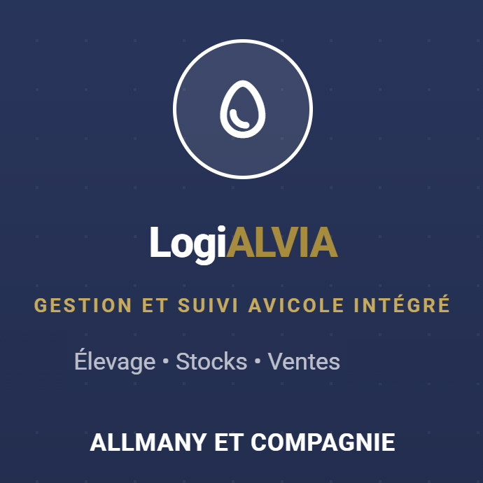
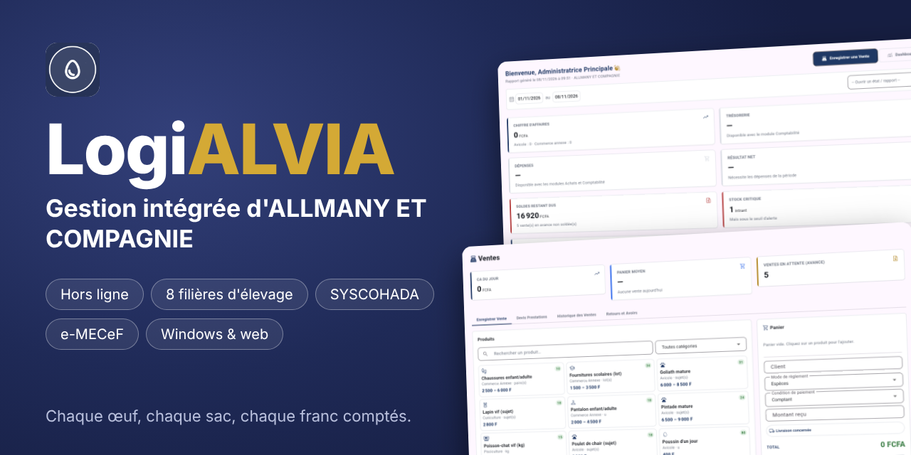
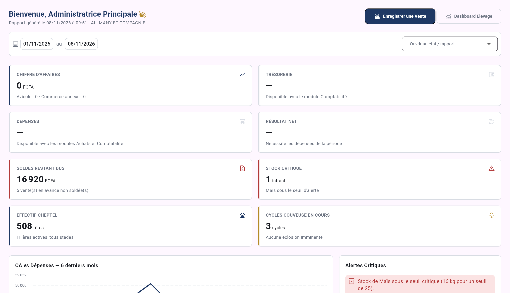
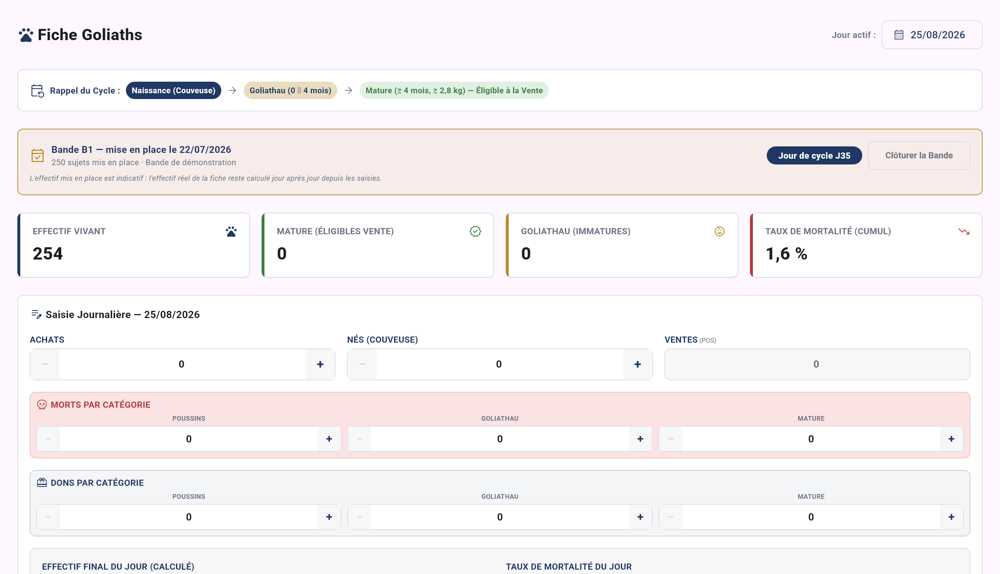
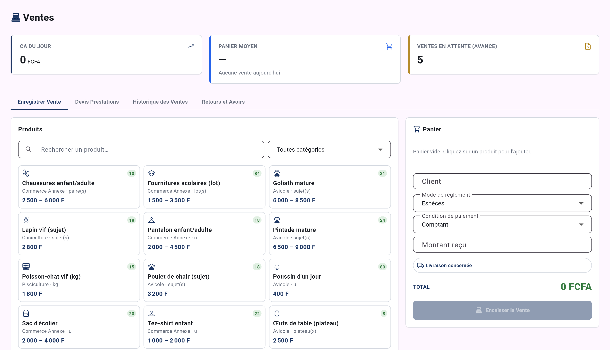
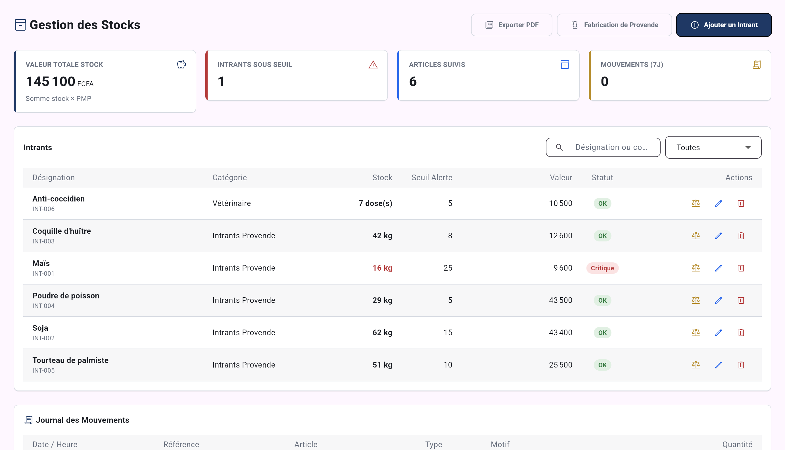
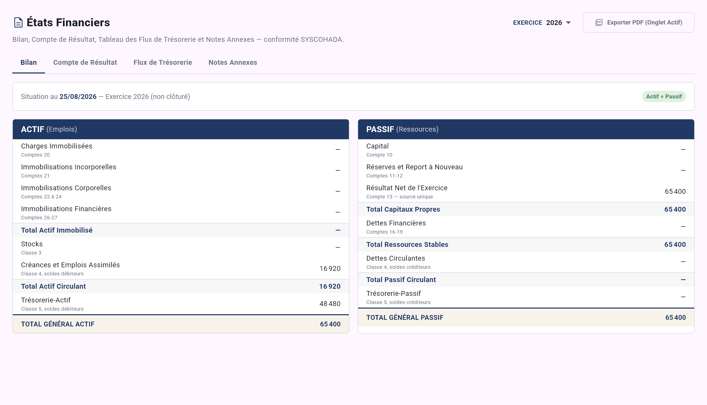

<div align="center">



# LogiALVIA

**Gestion intégrée d'ALLMANY ET COMPAGNIE**
de l'œuf mis en couveuse jusqu'au bilan de fin d'exercice.

`Hors ligne` · `8 filières d'élevage` · `Ventes & caisse` · `Stocks & achats` · `Comptabilité SYSCOHADA` · `e-MECeF` · `Windows & web`



*Chaque œuf, chaque sac, chaque franc comptés.*

</div>

---

## Le projet

LogiALVIA est un logiciel de gestion **tout-en-un** conçu pour une exploitation d'élevage qui vend aussi du commerce annexe. Il remplace le cahier, le tableur et la calculette par **un seul outil**, entièrement **en français**, qui fonctionne **sans connexion Internet** : la ferme n'a pas besoin du réseau pour travailler.

Il couvre toute la chaîne : ce qui naît et grandit dans les enclos, ce qui est acheté et stocké, ce qui est vendu en caisse, et ce que cela donne en comptabilité.

> Projet privé et personnel, tous droits réservés.

## Un seul outil, six métiers

| | |
|---|---|
| 🐓 **Élevage** | Huit filières suivies jour après jour, la couveuse, les soins et la prophylaxie |
| 🛒 **Ventes** | Caisse, devis, historique, retours et avoirs, clients et créances |
| 📦 **Stocks & achats** | Intrants, provende, commandes, fournisseurs, valorisation du stock |
| 📒 **Comptabilité** | Écritures automatiques, états financiers, clôture, conformité SYSCOHADA |
| 📊 **Pilotage** | Tableaux de bord, alertes, rapports et exports PDF |
| 🔐 **Administration** | Rôles et droits, sauvegardes, corbeille, modules à la carte |

---

## Tableau de bord

Dès l'ouverture, l'essentiel de la ferme tient sur un écran : chiffre d'affaires, trésorerie, dépenses, résultat net, soldes restant dus, stocks critiques, effectif du cheptel et cycles de couveuse en cours. Les alertes remontent d'elles-mêmes (stock sous le seuil, éclosion imminente, rappel de soin).



## Élevage

Huit filières, chacune avec sa fiche journalière, ses repères et ses règles propres :

**Goliaths** · **Pintades** · **Lapins** · **Poissons-chats** · **Poulets** · **Pondeuses** · **Escargots** · **Bovins**

- **Saisie du jour** : achats, naissances, morts par catégorie, dons, ventes reprises automatiquement depuis la caisse.
- **Bandes** : mise en place, jour de cycle, effectif réel recalculé jour après jour, clôture.
- **Couveuse** : cycles, mirages, taux d'éclosion et de perte.
- **Soins & prophylaxie** : calendrier des vaccins et vitamines, doses, infirmerie, rappels vétérinaires.
- **Rations** : barèmes et fabrication de provende.
- Les filières se **activent à la demande** : on ne voit que ce que la ferme pratique.



## Ventes et caisse

Une caisse pensée pour aller vite : on touche un produit, il entre au panier, le prix se négocie dans sa fourchette, le règlement se choisit (espèces, avance, crédit).

- Catalogue de produits vivants et de commerce annexe, avec **stock visible** sur chaque carte.
- **Devis de prestations**, historique des ventes, **retours et avoirs**.
- **Clients et créances** : qui doit quoi, depuis quand.
- **Facturation normalisée e-MECeF** : factures de vente et d'avoir conformes à l'exigence fiscale.



## Stocks et achats

Les intrants (maïs, soja, poudre de poisson, produits vétérinaires…) sont suivis avec leur **seuil d'alerte**, leur **prix moyen pondéré** et leur **valeur**. Chaque mouvement laisse une trace dans le journal. Les **achats** et les **fournisseurs** alimentent le stock et les dettes ; la **fabrication de provende** transforme les intrants en aliment.



## Comptabilité SYSCOHADA

Les opérations de la ferme deviennent **automatiquement des écritures comptables** : ventes, achats, règlements, dépenses.

Journal · Grand livre · Balance générale · Plan comptable · Saisie des dépenses · Comptabilité analytique · **États financiers** (bilan, compte de résultat, flux de trésorerie, notes annexes) · **Clôture d'exercice**.



## Rapports et exports

Trésorerie, créances, dettes, élevage, stocks, inventaire : chaque rapport s'ouvre à l'écran et s'exporte en **PDF** avec la même mise en page partout.

## Administration

- **Rôles et droits par module** : chacun ne voit et ne modifie que ce qui relève de son travail.
- **Modules à la carte** : on n'active que ce dont l'exploitation a besoin.
- **Sauvegardes** et **restauration**, **corbeille** pour récupérer ce qui a été supprimé par erreur.
- **Journal d'audit** de ce qui est fait, et par qui.
- **Données de démonstration** et visites guidées pour prendre l'outil en main.

---

## Où ça tourne

- **Poste Windows** (`logialvia_app/`) : l'application principale, installée sur l'ordinateur de la ferme. Elle travaille **sans réseau**.
- **Version web** (`logialvia_laravel/`) : même logique métier que le poste, mêmes écrans, mêmes droits ; elle sert de **serveur** de synchronisation.
- **Synchronisation** : plusieurs postes travaillent en parallèle ; leurs données se rejoignent sur le serveur, sans que deux caisses se marchent dessus (chaque poste a ses propres numéros de pièce, par exemple `V-P2-2026-001`). Le stock reste propre à chaque poste ; le journal des mouvements est partagé.
- **e-MECeF** : la transmission à la DGI et les secrets restent au poste ; le web n'en stocke aucun.

## Le dépôt

| Dossier | Contenu |
|---|---|
| [`logialvia_app/`](logialvia_app/) | Application Flutter (Windows), *offline-first* (Drift / SQLite) : **la référence** |
| [`logialvia_laravel/`](logialvia_laravel/) | Application web Laravel 12 + Livewire 3 (PHP 8.3, MySQL 8) : serveur et écrans web, conformes au Dart |
| [`docs/`](docs/) | Documentation (analyse, règles métier, contrats de synchronisation, décisions à valider) : point d'entrée [`docs/INDEX_MAITRE.md`](docs/INDEX_MAITRE.md) |
| [`docs/manuel/`](docs/manuel/) | Manuel d'utilisation (PDF, captures générées par les tests) |
| [`logo/`](logo/) | Logos sources |

[`CLAUDE.md`](CLAUDE.md) décrit l'architecture, les conventions et les pièges : à lire avant de modifier le code.

## Démarrage rapide

### Poste Windows — `logialvia_app/`

```bash
cd logialvia_app
flutter pub get
dart run build_runner build          # régénère le code de la base après un changement de schéma
flutter analyze                      # doit rester à « No issues found! »
flutter test
flutter run -d windows
build_windows.bat                    # build release + installateur LogiALVIA-Setup-<version>.exe (Inno Setup 6)
```

Première connexion : identifiant `admin`, mot de passe initial `ALLMANY2026` (à changer dans *Mon profil*).

### Application web — `logialvia_laravel/`

```bash
cd logialvia_laravel
composer install
npm ci
cp .env.example .env                 # renseigner DB_*, DB_TIMEZONE=+00:00, ADMIN_INITIAL_PASSWORD
php artisan key:generate
php artisan migrate --force
php artisan db:seed --force
npm run build
php artisan serve
php artisan test
```

## État et limites

Le poste et le web sont livrés et testés (suites Flutter et PHPUnit, essais contre un vrai serveur, parcours navigateur). Restent à faire ou à confirmer : la **transmission e-MECeF réelle** (jamais essayée contre la DGI ni un vrai boîtier ; adresses de l'API non confirmées), les **décisions métier à valider avec le client** (`docs/logialvia/46f_DECISIONS_A_VALIDER_P7_P9.md`), la **relecture du plan comptable** par un expert-comptable, et un premier essai de déploiement sur cPanel mutualisé.

## Documentation

- **Manuel d'utilisation** (PDF, illustré) : [`docs/manuel/LogiALVIA-Manuel-Utilisation.pdf`](docs/manuel/LogiALVIA-Manuel-Utilisation.pdf).
- **Synchronisation poste ↔ web** : [`docs/logialvia/46_CONTRAT_SYNCHRONISATION.md`](docs/logialvia/46_CONTRAT_SYNCHRONISATION.md).
- **Facturation normalisée e-MECeF** : [`docs/logialvia/41_MECEF_EMECEF.md`](docs/logialvia/41_MECEF_EMECEF.md) et [`47v_`](docs/logialvia/47v_MECEF_ETAT_DOCUMENTATION.md).
- **Plan comptable SYSCOHADA** : [`docs/logialvia/47p_PLAN_COMPTABLE_SYSCOHADA.md`](docs/logialvia/47p_PLAN_COMPTABLE_SYSCOHADA.md).
- **Installateur Windows** : [`docs/logialvia/47w_INSTALLATEUR_WINDOWS.md`](docs/logialvia/47w_INSTALLATEUR_WINDOWS.md).
- **Hébergement (Laragon, cPanel), MySQL, réseau** : [`docs/logialvia/47r_MYSQL_ET_RESEAU_REEL.md`](docs/logialvia/47r_MYSQL_ET_RESEAU_REEL.md).

---

## Contact

Pour un **usage commercial**, une **démonstration** ou une **collaboration** :

📧 **[rarhodes06@gmail.com](mailto:rarhodes06@gmail.com)**

<sub>© ALLMANY ET COMPAGNIE · Tous droits réservés. Projet privé : aucune reproduction ni utilisation commerciale sans accord écrit.</sub>
