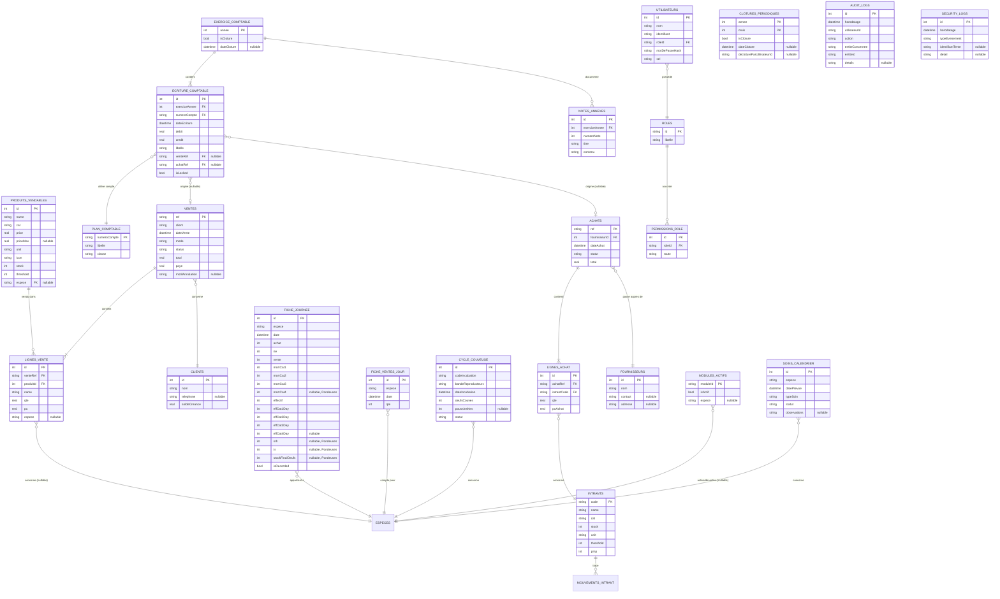

# D1 — Ingénierie Base de Données Complète — ERD, Dictionnaire, Contraintes, Migrations

Ce document remplace et enrichit `04_MODELE_DONNEES_PERSISTANCE.md` (conservé, mais D1 prévaut). Il couvre l'intégralité des modules — la première version ne couvrait que Stock/Ventes/Fiches d'Élevage.

---

## 1. Diagramme Entité-Relation (ERD) — Vue Complète



---

## 2. Dictionnaire de Données Complet

### `PRODUITS_VENDABLES`
| Colonne | Type | Contrainte | Description |
|---|---|---|---|
| `id` | INTEGER | PK, AUTOINCREMENT | Identifiant technique |
| `name` | TEXT | NOT NULL | Désignation affichée sur le POS |
| `cat` | TEXT | NOT NULL, IN ('Avicole','Commerce Annexe') | Catégorie de classement |
| `price` | REAL | NOT NULL, ≥ 0 | Prix indicatif bas (ou unique si pas de fourchette) |
| `priceMax` | REAL | NULLABLE, ≥ price si renseigné | Prix indicatif haut (fourchette de négociation) |
| `unit` | TEXT | NOT NULL | Unité de vente ('u', 'sujet(s)', 'lot(s)', 'paire(s)') |
| `stock` | INTEGER | NOT NULL, ≥ 0 (BR-ELV-001 appliqué par extension) | Quantité disponible |
| `threshold` | INTEGER | NOT NULL, ≥ 0 | Seuil déclenchant le badge "Critique" |
| `espece` | TEXT | NULLABLE, FK logique vers identifiant d'espèce | Lien vers la fiche d'élevage concernée si le produit est un animal vivant |

### `INTRANTS`
| Colonne | Type | Contrainte | Description |
|---|---|---|---|
| `code` | TEXT | PK | Identifiant métier (ex: 'INT-001') |
| `name` | TEXT | NOT NULL | Désignation |
| `cat` | TEXT | NOT NULL, IN ('Intrants Provende','Marchandises','Vétérinaire') | Catégorie |
| `stock` | INTEGER | NOT NULL, ≥ 0 | Quantité en stock |
| `unit` | TEXT | NOT NULL | Unité ('kg', 'dose(s)', 'u') |
| `threshold` | INTEGER | NOT NULL, ≥ 0 | Seuil d'alerte |
| `pmp` | INTEGER | NOT NULL, ≥ 0 | Prix Moyen Pondéré, FCFA |

### `VENTES`
| Colonne | Type | Contrainte | Description |
|---|---|---|---|
| `ref` | TEXT | PK, format 'V-AAAA-NNN' | Référence unique |
| `client` | TEXT | NOT NULL | Nom du client (ou 'Client Comptant') |
| `dateVente` | DATETIME | NOT NULL | Horodatage de la transaction |
| `mode` | TEXT | NOT NULL, IN ('Espèces','Mobile Money') — **'Non précisé'** pour les ventes antérieures à v15 | **Instrument** de paiement. ⚠️ Ne contient plus 'Avance (Solde Restant Dû)' : c'était une condition de paiement, pas un mode. Voir v15 |
| `status` | TEXT | NOT NULL, IN ('Payée','Avance','Annulée') | Statut de la vente — porte aussi la **condition de paiement** : 'Avance' ⇒ vente à crédit, 'Payée' ⇒ comptant (`ConditionPaiement.depuisStatut`) |
| `total` | REAL | NOT NULL, ≥ 0 | Montant total (BR-VTE-003 : respecte la remise appliquée) |
| `paye` | REAL | NOT NULL, ≥ 0, ≤ total | Montant effectivement encaissé |
| `motifAnnulation` | TEXT | NULLABLE, NOT NULL si status='Annulée' | Motif obligatoire en cas d'annulation |
| `ligneMobileMoney` | TEXT | NULLABLE | Ligne Mobile Money créditée, **au moment de la vente**. `null` en espèces et sur toute vente antérieure à v16. Voir v16 |
| `echeance` | DATETIME | NULLABLE | Date d'exigibilité convenue — « Payable le ». `null` = aucun délai fixé : la créance est « **Sans échéance** » et **n'est jamais déclarée en retard**. Voir v17 |

### `LIGNES_VENTE`
| Colonne | Type | Contrainte | Description |
|---|---|---|---|
| `id` | INTEGER | PK, AUTOINCREMENT | Identifiant technique |
| `venteRef` | TEXT | FK → VENTES.ref, NOT NULL, ON DELETE CASCADE | Vente parente |
| `produitId` | INTEGER | FK → PRODUITS_VENDABLES.id, NOT NULL | Produit vendu |
| `name` | TEXT | NOT NULL | Nom du produit **au moment de la vente** (dénormalisé volontairement pour historique fidèle même si le produit est renommé plus tard) |
| `qte` | REAL | NOT NULL, > 0 | Quantité vendue |
| `pu` | REAL | NOT NULL, ≥ 0 | Prix unitaire appliqué à cette vente |
| `espece` | TEXT | NULLABLE | Espèce concernée si le produit est un animal (déclenche BR-ELV-010) |

### `FICHE_JOURNEE`
| Colonne | Type | Contrainte | Description |
|---|---|---|---|
| `id` | INTEGER | PK, AUTOINCREMENT | Identifiant technique |
| `espece` | TEXT | NOT NULL, IN ('goliaths','pintades','lapins','poulets','pondeuses','poissons-chats') | Identifie la fiche |
| `date` | DATETIME | NOT NULL | Jour concerné (UNIQUE avec `espece`) |
| `achat`, `ne`, `vente` | INTEGER | NOT NULL, DEFAULT 0, ≥ 0 | Mouvements du jour |
| `mortCat1..4` | INTEGER | NOT NULL (1-3) / NULLABLE (4), DEFAULT 0, ≥ 0 | Mortalité par catégorie (BR-ELV-004) |
| `donCat1..4` | INTEGER | NOT NULL (1-3) / NULLABLE (4), DEFAULT 0, ≥ 0 | Dons par catégorie |
| `effectif` | INTEGER | NOT NULL, ≥ 0, **calculé, non saisi** (BR-ELV-007) | Effectif total du jour |
| `effCat1..4Day` | INTEGER | NOT NULL (1-3) / NULLABLE (4), ≥ 0 | Sous-effectifs par catégorie |
| `srh`, `ts`, `stockFinalOeufs` | INTEGER | NULLABLE (Pondeuses uniquement) | Voir BR-ELV-008 |
| `isRecorded` | BOOLEAN | NOT NULL, DEFAULT FALSE | Distingue un jour saisi d'un jour projeté/vide |

**Contrainte d'unicité** : `UNIQUE(espece, date)` — un seul enregistrement par espèce et par jour.

### `FICHE_VENTES_JOUR`
| Colonne | Type | Contrainte | Description |
|---|---|---|---|
| `id` | INTEGER | PK, AUTOINCREMENT | — |
| `espece` | TEXT | NOT NULL | — |
| `date` | DATETIME | NOT NULL, normalisée à minuit | — |
| `qte` | INTEGER | NOT NULL, ≥ 0 | Cumul du jour (peut être incrémenté plusieurs fois si plusieurs ventes le même jour) |

**Contrainte d'unicité** : `UNIQUE(espece, date)`.

### `CYCLE_COUVEUSE`
| Colonne | Type | Contrainte | Description |
|---|---|---|---|
| `id` | INTEGER | PK, AUTOINCREMENT | — |
| `codeIncubation` | TEXT | NOT NULL, UNIQUE | Ex: 'INCUB-2026-08' |
| `bandeReproducteurs` | TEXT | NOT NULL | — |
| `dateIncubation` | DATETIME | NOT NULL | Jour 0 |
| `oeufsCouves` | INTEGER | NOT NULL, > 0 | — |
| `poussinsNes` | INTEGER | NULLABLE, ≤ oeufsCouves | Renseigné à l'éclosion (J+21) |
| `statut` | TEXT | NOT NULL, IN ('En Incubation','Éclosion Effectuée') | — |

### `SOINS_CALENDRIER`
| Colonne | Type | Contrainte | Description |
|---|---|---|---|
| `id` | INTEGER | PK, AUTOINCREMENT | — |
| `espece` | TEXT | NOT NULL | — |
| `datePrevue` | DATETIME | NOT NULL | — |
| `typeSoin` | TEXT | NOT NULL | Vaccin, traitement, etc. |
| `statut` | TEXT | NOT NULL, IN ('Planifié','Effectué','En retard','Traitement en cours') | — |
| `observations` | TEXT | NULLABLE | — |

### `EXERCICE_COMPTABLE`
| Colonne | Type | Contrainte | Description |
|---|---|---|---|
| `annee` | INTEGER | PK | Ex: 2026 |
| `isCloture` | BOOLEAN | NOT NULL, DEFAULT FALSE | BR-CPT-001 |
| `dateCloture` | DATETIME | NULLABLE, NOT NULL si isCloture=TRUE | — |

### `PLAN_COMPTABLE`
| Colonne | Type | Contrainte | Description |
|---|---|---|---|
| `numeroCompte` | TEXT | PK | Ex: '531' (Caisse), '701' (Ventes). **Immuable** : c'est la FK de toutes les écritures passées |
| `libelle` | TEXT | NOT NULL | — |
| `classe` | TEXT | NOT NULL, 1 caractère (1 à 7, SYSCOHADA) | Classe comptable. Ne peut plus changer dès que le compte porte une écriture |
| `archive` | BOOLEAN | NOT NULL, DEFAULT FALSE | ⚠️ **ajoutée à l'implémentation** — `plan-comptable.html` propose un bouton « Archiver ». Un compte archivé n'est plus proposé à la saisie mais ses écritures restent au Journal, au Grand Livre et dans la Balance |

**Sens naturel du solde (BR-CPT-007)** — dérivé, non stocké : classes 2/3/6 débitrices, 1/7 créditrices ; pour les classes **4 et 5**, bidirectionnelles, l'arbitrage se fait sur le numéro (411 débiteur ; 419, 40x, 42x, 43x, 44x créditeurs ; classe 5 débitrice sauf découvert). Voir Doc F6 §10.7 — le prototype et le §2 de Doc F6 rangeaient les classes 4 et 5 des deux côtés.

**Contenu du socle (`PlanComptableSeeder`)** — 19 comptes, en 3 groupes traçables :

| Groupe | Comptes | Source |
|---|---|---|
| Réels | 31, 32, 401, 411, 419, 512, 531, 601, 602, 622, 701, 707 | `plan-comptable.html` l.179-192 |
| Capitaux ajoutés | 101, 121, 131 | **Manque du prototype** : aucun compte de classe 1, donc aucun Bilan possible (Doc F6 §10.2) |
| Charges ajoutées | 613, 616, 624, 628 | **Incohérence du prototype** : utilisés par `saisie-depenses.html`, absents de `plan-comptable.html` (Doc F6 §10.3) |

Le peuplement est **complétif, jamais destructif** : à chaque démarrage, les numéros absents sont insérés ; un compte renommé ou archivé par la Gérante n'est jamais réécrasé.

### `ECRITURE_COMPTABLE`
| Colonne | Type | Contrainte | Description |
|---|---|---|---|
| `id` | INTEGER | PK, AUTOINCREMENT | — |
| `exerciceAnnee` | INTEGER | FK → EXERCICE_COMPTABLE.annee, NOT NULL | — |
| `numeroCompte` | TEXT | FK → PLAN_COMPTABLE.numeroCompte, NOT NULL | — |
| `dateEcriture` | DATETIME | NOT NULL | — |
| `debit`, `credit` | REAL | NOT NULL, DEFAULT 0, ≥ 0, **exactement un des deux > 0** | Partie double |
| `libelle` | TEXT | NOT NULL | — |
| `journalCode` | TEXT | NOT NULL, DEFAULT 'OD' | ⚠️ **ajoutée à l'implémentation** — VT (Ventes), AC (Achats), CA (Caisse), OD (Opérations Diverses). Sans elle, le filtre par journal du Journal Comptable serait décoratif et un journal SYSCOHADA n'est pas un flux indifférencié |
| `numeroPiece` | TEXT | NULLABLE | ⚠️ **ajoutée à l'implémentation** — regroupe les lignes d'une même pièce. `saisie-depenses.html` et `journal-comptable.html` affichent tous deux un « N° Pièce » que le dictionnaire ne prévoyait pas. C'est aussi la clé de suppression : une pièce se supprime entière, jamais ligne à ligne (Doc F6 §10.15) |
| `venteRef` | TEXT | FK → VENTES.ref, NULLABLE | Origine si générée automatiquement (BR-CPT-003) |
| `achatRef` | TEXT | FK → ACHATS.ref, NULLABLE | — |
| `isLocked` | BOOLEAN | NOT NULL, DEFAULT FALSE | Vrai si l'exercice parent est clôturé |

**Aucun axe analytique.** Cette table ne porte ni centre de coût ni espèce. C'est la raison pour laquelle la Comptabilité Analytique demandée en Doc F6 §7 (« Compte de Résultat par Centre de Profit, filtré par `espece`/centre ») **n'est pas réalisable en l'état** ; l'encadré du §7 détaille les 4 décisions à arbitrer avant d'ajouter cet axe.

### `FOURNISSEURS`
| Colonne | Type | Contrainte | Description |
|---|---|---|---|
| `id` | INTEGER | PK, AUTOINCREMENT | — |
| `nom` | TEXT | NOT NULL | — |
| `contact`, `adresse` | TEXT | NULLABLE | — |

### `ACHATS` / `LIGNES_ACHAT`
Structure symétrique à `VENTES`/`LIGNES_VENTE`, avec `fournisseurId` (FK) au lieu de `client`, et `intrantCode` (FK vers `INTRANTS.code`) au lieu de `produitId`.

### `UTILISATEURS` / `ROLES` / `PERMISSIONS_ROLE`
| Table | Colonnes clés | Description |
|---|---|---|
| `ROLES` | `id` (PK, ex: 'admin','caissier','animalier'), `libelle` | Référentiel des 3 rôles réels (Doc I1, corrigé suite à Doc K4 §8 — aucun rôle 'comptable' distinct) |
| `UTILISATEURS` | `id`, `nom`, `identifiant` (UNIQUE), `roleId` (FK), `motDePasseHash`, `sel` | Voir le détail ci-dessous |
| `PERMISSIONS_ROLE` | `id`, `roleId` (FK), `route` (ex: '/comptabilite') | Une ligne par route autorisée pour un rôle (BR-ADM-001) |

#### `UTILISATEURS` — détail (⚠️ corrigé à l'implémentation du module F1)

| Colonne | Type | Contrainte | Description |
|---|---|---|---|
| `id` | INTEGER | PK, AUTOINCREMENT | — |
| `nom` | TEXT | NOT NULL | Nom affiché du compte |
| `identifiant` | TEXT | NOT NULL, UNIQUE | Libellé du champ côté prototype : *"NOM D'UTILISATEUR OU EMAIL"* (`login.html`) — accepte donc un pseudo **ou** une adresse e-mail |
| `roleId` | TEXT | FK → ROLES.id, NOT NULL | — |
| `motDePasseHash` | TEXT | NOT NULL | SHA-256 hexadécimal (64 caractères) de `sel + motDePasse` |
| `sel` | TEXT | NOT NULL | Sel aléatoire base64 (16 octets), **propre à chaque compte** |

**⚠️ Correction apportée par l'implémentation réelle du module F1** : la version précédente de ce dictionnaire ne listait que `id`, `nom`, `identifiant`, `roleId`. **Aucune colonne ne permettait de stocker un secret d'authentification** — le schéma tel que documenté rendait donc l'écran de connexion (Doc F1 Écran 3) structurellement impossible à implémenter, alors même que Doc K4 §8 référençait déjà un champ `motDePasseHash` dans son extrait de seeder. Les 2 colonnes ci-dessus comblent ce manque, selon le mécanisme recommandé en Doc F1 « Point Ouvert » (SHA-256 + sel), **confirmé et validé explicitement avant implémentation**.

**Règle stricte** : le mot de passe en clair n'est jamais persisté, jamais journalisé (ni dans `AUDIT_LOGS`, ni dans `SECURITY_LOGS`). La comparaison de hash se fait en temps constant, pour ne pas fuiter d'information par le temps d'exécution.

### `MODULES_ACTIFS`
| Colonne | Type | Contrainte | Description |
|---|---|---|---|
| `moduleId` | TEXT | PK | Ex: 'poissons-chats' |
| `isActif` | BOOLEAN | NOT NULL, DEFAULT TRUE | BR-ADM-002 |
| `espece` | TEXT | NULLABLE | Si le module correspond à une filière d'élevage |

### `NOTES_ANNEXES`
| Colonne | Type | Contrainte | Description |
|---|---|---|---|
| `id` | INTEGER | PK, AUTOINCREMENT | — |
| `exerciceAnnee` | INTEGER | FK → EXERCICE_COMPTABLE.annee, NOT NULL | — |
| `numeroNote` | INTEGER | NOT NULL, 1 à 5 | Voir Doc F6 §4 Onglet 4 pour le contenu attendu de chaque note |
| `titre` | TEXT | NOT NULL | — |
| `contenu` | TEXT | NOT NULL | Texte libre ou JSON structuré selon la note |

**Contrainte d'unicité** : `UNIQUE(exerciceAnnee, numeroNote)`.

### `CLOTURES_PERIODIQUES`
| Colonne | Type | Contrainte | Description |
|---|---|---|---|
| `annee` | INTEGER | PK (composite avec `mois`) | — |
| `mois` | INTEGER | PK (composite), 1 à 12 | — |
| `isCloture` | BOOLEAN | NOT NULL, DEFAULT FALSE | BR-CPT-006 |
| `dateCloture` | DATETIME | NULLABLE | — |
| `declotureParUtilisateurId` | TEXT | NULLABLE | Traçabilité du déblocage exceptionnel (BR-ADM-003), rôle `admin` uniquement |

**Contrainte transversale sur `ECRITURE_COMPTABLE`** : toute écriture datée dans un mois où `CLOTURES_PERIODIQUES.isCloture=TRUE` est refusée en modification, en plus de la vérification déjà existante sur `EXERCICE_COMPTABLE.isCloture` (double verrouillage, BR-CPT-001 + BR-CPT-006).

### `AUDIT_LOGS`
| Colonne | Type | Contrainte | Description |
|---|---|---|---|
| `id` | INTEGER | PK, AUTOINCREMENT | — |
| `horodatage` | DATETIME | NOT NULL | — |
| `utilisateurId` | TEXT | NOT NULL | — |
| `action` | TEXT | NOT NULL, IN ('suppression','modification','cloture','decloture','connexion') | Voir Doc I3 §6 pour la liste complète des actions journalisées |
| `entiteConcernee` | TEXT | NOT NULL | Ex: 'Vente', 'Produit', 'ExerciceComptable' |
| `entiteId` | TEXT | NOT NULL | — |
| `details` | TEXT | NULLABLE | JSON des valeurs avant/après si pertinent |

### `SECURITY_LOGS`
| Colonne | Type | Contrainte | Description |
|---|---|---|---|
| `id` | INTEGER | PK, AUTOINCREMENT | — |
| `horodatage` | DATETIME | NOT NULL | — |
| `typeEvenement` | TEXT | NOT NULL, IN ('echec_connexion','acces_route_non_autorise','tentative_modification_verrouillee') | Doc I3 §6 |
| `identifiantTente` | TEXT | NULLABLE | — |
| `detail` | TEXT | NULLABLE | — |

### `CLIENTS`
| Colonne | Type | Contrainte | Description |
|---|---|---|---|
| `id` | INTEGER | PK, AUTOINCREMENT | — |
| `nom` | TEXT | NOT NULL | — |
| `telephone` | TEXT | NULLABLE | — |
| `soldeCreance` | REAL | NOT NULL, DEFAULT 0 | Somme des ventes en statut 'Avance' non soldées |

---

## 3. Stratégie de Migration

Drift gère les migrations via un numéro de schéma incrémental :

```dart
@DriftDatabase(tables: [ProduitsVendables, Intrants, Ventes, LignesVente,
    FicheJournee, FicheVentesJour, CycleCouveuse, SoinsCalendrier,
    ExerciceComptable, PlanComptable, EcritureComptable, NotesAnnexes, CloturesPeriodiques,
    Fournisseurs, Achats, LignesAchat, Utilisateurs, Roles,
    PermissionsRole, ModulesActifs, Clients, AuditLogs, SecurityLogs])
class AppDatabase extends _$AppDatabase {
  @override
  int get schemaVersion => 1;

  @override
  MigrationStrategy get migration => MigrationStrategy(
    onCreate: (m) async {
      await m.createAll();
      await _seedInitialData(); // DEFAULT_STOCK, DEFAULT_INTRANTS, DEFAULT_VENTES (Doc D, section seed)
    },
    onUpgrade: (m, from, to) async {
      // Chaque montee de version = un bloc explicite, jamais de migration destructive
      // if (from < 2) { await m.addColumn(...); }
    },
  );
}
```

**Règle de migration** : toute évolution de schéma après la version 1 ajoute un bloc `if (from < N)` explicite — jamais de `DROP TABLE`/recreate destructif sur une base contenant déjà des données réelles de production.

### Périmètre réel du schéma à ce stade (état d'avancement, pas une spécification)

Le bloc `@DriftDatabase` ci-dessus décrit la **cible complète**. L'implémentation réelle procède par module, chaque module ajoutant ses tables via une montée de `schemaVersion` et un bloc `if (from < N) { await m.createTable(...); }` explicite.

| Version | Module | Tables créées |
|---|---|---|
| **v1** | F1 — Authentification | `Roles`, `Utilisateurs`, `PermissionsRole`, `AuditLogs`, `SecurityLogs` |
| **v2** | F2 — Pilotage | `ModulesActifs`, `ProduitsVendables`, `Clients`, `Ventes`, `LignesVente`, `Intrants`, `FicheJournee`, `FicheVentesJour`, `CycleCouveuse`, `SoinsCalendrier` |
| **v3** | F3 — Production Élevage | Colonnes ajoutées à `FicheJournee` : `poidsGeneralG`, `traitementObs`, `traitementValide` |
| **v4** | F3 — Cycle Couveuse | `CycleCouveuse` : `espece` et `oeufsPerdus` ajoutées, `bandeReproducteurs` rendue nullable |
| **v5** | F3 — Calendrier de Soins | `SoinsCalendrier` : 6 colonnes ajoutées ; **table `Infirmerie` créée** |
| **v6** | H2 — Fiche Pondeuses | `FicheJournee` : `oeufsPondus`, `oeufsCasses`, `sortiesPlateaux` |
| **v7** | F8 — Paramètres Généraux | **Table `ParametresEntreprise` créée** |
| **v8** | F4 / H1 — Ventes | **Table `Devis` créée** |
| **v9** | F4 — Catalogue & Clients | `ProduitsVendables.sku` ; `Clients.dateNaissance` et `Clients.dernierContact` |
| **v10** | F5 — Stocks & Achats | Tables `Fournisseurs`, `Achats`, `LignesAchat` et **`MouvementsIntrant`** créées |
| **v11** | F6 — Comptabilité SYSCOHADA | Tables **`ExerciceComptable`**, **`PlanComptable`**, **`EcritureComptable`**, **`NotesAnnexes`** et **`CloturesPeriodiques`** créées |
| **v12** | F3 — Paramètres Élevage | Tables **`BaremesRation`** et **`CalendrierProphylaxie`** créées ; 4 colonnes de préfixes de numérotation ajoutées à `ParametresEntreprise` |
| **v13** | F9 — Compte Utilisateur | Table **`MessagesEditeur`** créée |
| **v14** | H1 — Livraison au point de vente | 4 colonnes ajoutées à `VENTES` : `livraisonMode`, `livraisonFrais`, `livraisonAdresse`, `livraisonContact`. La modale `#modal-livraison` du prototype affiche ces champs mais `validateSale()` n'en lit **aucun** — rien n'était persisté, et les frais d'une livraison « facturée séparément » n'entraient pas dans le total |

| **v15** | F8 — « Avance » est une condition de paiement | **Aucune colonne créée.** `UPDATE ventes SET mode = 'Non précisé' WHERE mode = 'Avance (Solde Restant Dû)'`. La condition se lit désormais sur `status`, où elle était **déjà** stockée — l'information était donc redondante, et la version stockée dans `mode` écrasait l'instrument réel. Les ventes migrées n'ont jamais enregistré cet instrument : il est inconnu, et « Non précisé » le dit plutôt que de choisir « Espèces » à leur place. `status`, `total` et `paye` restent intacts : les créances en cours ne bougent pas |

| **v16** | K2 §B — ligne Mobile Money du point de vente | Colonne `ligneMobileMoney` (TEXT, NULLABLE) ajoutée à `VENTES`. `#modal-account-select` de `ventes.html` **exige** un choix que `validateSale()` ne conserve nulle part : une obligation dont le résultat est jeté. La ligne est désormais copiée sur la vente, dénormalisée comme `LIGNES_VENTE.nom` — si le numéro de l'entreprise change, les encaissements passés doivent continuer de nommer la ligne qui les a reçus, sinon le rapprochement du compte 512 devient faux rétroactivement. Les ventes antérieures restent à NULL : leur ligne créditée n'a jamais été enregistrée |

| **v17** | Échéances de paiement | Colonnes `echeance` (DATETIME, NULLABLE) sur **`VENTES`** et **`ACHATS`**, et `delaiPaiementJours` (INTEGER, NULLABLE) sur `PARAMETRES_ENTREPRISE`. ⚠️ **Correction d'un défaut qui produisait des documents faux** : `CreanceClient.echeance` retournait `dateVente`, donc `joursDeRetard = aujourd'hui − date de vente`. Toute créance née la veille était affichée « En Retard » avec un compteur mesurant en réalité son âge — et depuis que la **lettre de relance** s'imprime depuis ce tableau, la Gérante pouvait réclamer un paiement non échu à un vrai client. Même défaut sur `DetteFournisseur` (`echeance => dateAchat`) ; le prototype faisait pire, sa seule dette étant exigible **la veille** de l'achat qu'elle règle. Les lignes existantes restent à NULL : leur délai n'a jamais été convenu, elles ne peuvent donc pas être en retard |

| **v18** | Coût de revient des produits finis | Colonne `coutRevient` (REAL, NULLABLE) sur **`PRODUITS_VENDABLES`**. ⚠️ Le Rapport de Stocks valorisait le stock au **prix de vente** : le prototype remplit sa colonne « CMUP » avec le prix du catalogue, à l'identique (`price:6000` / `cmup:6000` pour le Goliath mature). Un animal encore dans l'enclos y valait donc le montant qu'il n'a pas encore rapporté — surévaluation du stock et anticipation d'une marge non réalisée. Les lignes existantes restent à NULL : reconduire le prix de vente comme coût perpétuerait la surévaluation. Un produit sans coût n'est **pas valorisé**, et le KPI annonce combien d'articles il exclut |

| **v19** | Axe analytique | Colonne `axeAnalytique` (TEXT, NULLABLE) sur **`ECRITURE_COMPTABLE`**. Sans elle, la Comptabilité Analytique ne ventilait que ce que le **numéro de compte** laisse deviner : une facture d'électricité (628) restait hors de toute filière, et tout l'avicole formait un bloc unique alors que `comptabilite-analytique.html` l.146-149 sépare bien Goliaths et Pintades. Renseignée automatiquement sur les écritures de vente (depuis `PRODUITS_VENDABLES.espece`) et au choix sur les dépenses. **L'axe prime sur l'heuristique du compte, et une ligne imputée n'est jamais recomptée.** Les écritures antérieures restent à NULL et retombent sur l'heuristique — deviner leur imputation serait de l'invention |

| **v20** | Préférences du poste | Table **`PREFERENCES_POSTE`** (clé TEXT PK, valeur TEXT) créée. Deux réglages du prototype ne survivaient pas au redémarrage : la barre latérale repliée (`localStorage.logialvia_sidebar_hidden`) et « Se souvenir de moi », cette dernière n'écrivant **rien du tout** — une case à cocher qui ne pilotait qu'elle-même, dernier manquement debout à la règle §2.3. ⚠️ Seul l'**identifiant** est mémorisé, jamais la session : le poste est partagé entre 3 rôles dont un point de vente qui manipule des espèces. Séparée de `PARAMETRES_ENTREPRISE`, qui décrit l'entreprise et suivrait la base copiée ailleurs |

| **v21** | Couveuse multi-âges (incubation en continu) | Table **`MACHINES_INCUBATEUR`** créée (code, libellé, capacité). 4 colonnes ajoutées à `CYCLE_COUVEUSE` : `machineId`, `oeufsBlancsJ7` (`B_i(7)`), `oeufsGatesJ14` (`M_i(14)`), `lotParentId`. Le statut gagne « **Remplacé** ». ⚠️ **La pintade incube 28 jours, pas 27** — le prototype écrit `data-duree="27"`, corrigé par la Gérante : sur un couvoir en rotation, un jour d'écart se répète à chaque lot. **Date et quantité de remplacement ne sont PAS des colonnes** : pour un sous-lot ce sont sa propre date d'insertion et sa quantité initiale, exposées en getters — deux copies finiraient par diverger. L'historique des remplacements est la chaîne des `lotParentId`. Les lots existants restent à NULL sur les mirages : leur inventer des zéros donnerait un TER égal au taux brut en le présentant comme un taux réel |

| **v22** | Corbeille — « supprimer » archive | Table **`CORBEILLE`** créée : nom de table d'origine, module, type, désignation, **copie JSON complète de la ligne**, date et auteur. Les 8 suppressions ouvertes à l'utilisateur y passent (produits, intrants, barèmes, échéances de prophylaxie, lots d'incubation, utilisateurs, écritures, messages). Choix d'une corbeille plutôt qu'un drapeau `archive` par table : un booléen aurait imposé de filtrer **toutes** les requêtes de l'application, et une seule oubliée ferait réapparaître un intrant supprimé dans une fabrication de provende. Le nom de table vient d'une **liste blanche stricte** — il part dans une requête SQL à la restauration |
| **v23** | Verrou du mode « Données de Test » | Colonne `modeDonneesTest` (BOOL, défaut **faux**) sur `PARAMETRES_ENTREPRISE`. Elle conditionne l'onglet de réinitialisation. **Faux y compris sur les bases existantes** : une exploitation déjà en service ne doit pas hériter d'un accès à la remise à zéro |
| **v24** | Report d'un décès d'infirmerie sur la fiche d'élevage | Colonne `categorieMortalite` (INTEGER, NULLABLE) sur **`INFIRMERIE`** — index de la catégorie d'effectif dans laquelle la perte a été portée. ⚠️ `soins-calendrier.html` l.326 promet que le décès « sera reflété dans le décompte de mortalité de la fiche d'élevage correspondante » : rien, dans le prototype, ne le fait. Un animal isolé puis mort sortait donc de l'effectif sans jamais entrer dans le taux de mortalité — le chiffre était faux, silencieusement. La colonne reste **NULL tant que le report n'a pas eu lieu** : c'est elle qui distingue « décédé » de « décédé **et compté** », et donc ce qui empêche le double comptage. Les entrées antérieures restent à NULL : leur catégorie n'a jamais été demandée, la deviner fausserait un effectif |
| **v25** | Date de mise en bande — le point ouvert le plus ancien du projet | Table **`BANDES`** créée (espèce, code, `dateMiseEnBande`, effectif initial indicatif, date de clôture, observations ; `UNIQUE(espece, code)`), plus `bandeId` et `echeanceProphylaxieId` (INTEGER, NULLABLE) sur **`SOINS_CALENDRIER`**. ⚠️ `CALENDRIER_PROPHYLAXIE` indexe ses échéances sur le **jour du cycle** — arbitrage tranché par le contenu lui-même (cure « Jour 1/4 → 4/4 », anti-stress « post-éclosion », rappel Newcastle programmé sur l'âge du sujet). Mais **aucune table ne disait quand le cycle commence** : « J5 » ne se convertissait en aucune date, et l'injection annoncée par `parametres-elevage.html` est restée impossible depuis le début du projet. `BANDES` ne redécoupe **pas** `FICHE_JOURNEE`, qui reste tenue par filière et par jour : répartir un effectif entre bandes concomitantes supposerait une information que personne n'a saisie, et la deviner fausserait tous les effectifs déjà enregistrés. `effectifInitial` est donc **indicatif** et n'alimente aucun calcul. Le couple (`bandeId`, `echeanceProphylaxieId`) rend la planification **idempotente** : deux bandes mises en place le même jour partagent espèce, date et traitement — seul ce couple les distingue. Les soins existants restent à NULL, ils ont été saisis à la main et ne découlent d'aucune échéance |

**Note sur v11** : le passage à 19 comptes du plan comptable (Doc F6 §10.2 et §10.3) **n'a pas nécessité de montée de version** — c'est un peuplement, pas un changement de schéma. Il est assuré à chaque démarrage par `PlanComptableSeeder.completerComptesManquants()`, qui n'insère que les numéros absents. Vérifié sur une base réelle déjà en v11 : 15 → 19 comptes, `PRAGMA user_version` inchangé à 11, aucune autre table modifiée.

### `MESSAGES_EDITEUR` — absente du dictionnaire, créée en v13

`contact-editeur.html` affiche `showToast('Message envoyé à l'éditeur.')` **sans rien envoyer ni rien conserver** — l'anti-patron que le Master Prompt §2.3 interdit. L'application est hors-ligne et aucun transport e-mail n'est configuré (le mot de passe SMTP n'est volontairement pas stocké, Doc I3 §3).

Plutôt que de supprimer les formulaires ou de reproduire un faux succès, le message est conservé, copié dans le presse-papiers prêt à l'envoi, et son acheminement reste à la main de la Gérante.

| Colonne | Type | Contrainte | Description |
|---|---|---|---|
| `id` | INTEGER | PK, AUTOINCREMENT | — |
| `horodatage` | DATETIME | NOT NULL | — |
| `type` | TEXT | NOT NULL, IN ('question','bug') | Les 2 onglets du formulaire |
| `sujet` | TEXT | NOT NULL | Objet (onglet Question) ou module concerné (onglet Problème) |
| `message` | TEXT | NOT NULL | — |
| `etapes` | TEXT | NULLABLE | « Étapes pour Reproduire », onglet Problème uniquement |
| `utilisateurId` | TEXT | NOT NULL | Traçabilité de la rédactrice |
| `statut` | TEXT | NOT NULL, DEFAULT 'En attente' | « En attente » ou « Transmis » — aucun envoi automatique n'existe |

### `BAREMES_RATION` et `CALENDRIER_PROPHYLAXIE` — absentes du dictionnaire, créées en v12

`parametres-elevage.html` annonce configurer « les barèmes utilisés automatiquement dans les fiches de saisie journalière ». Aucune table ne permettait de les stocker : le prototype les garde dans deux tableaux JavaScript (`RATIONS`, `PROPHYLAXIE_STORE`) remis à zéro à chaque rechargement de page. Sans persistance, l'écran serait un formulaire sans effet (Master Prompt §2.3), et les rations vivraient en double — une fois ici, une fois en dur dans le calcul de provende.

#### `BAREMES_RATION`
| Colonne | Type | Contrainte | Description |
|---|---|---|---|
| `id` | INTEGER | PK, AUTOINCREMENT | — |
| `espece` | TEXT | NOT NULL | Même valeur que `FICHE_JOURNEE.espece` |
| `stade` | TEXT | NOT NULL | Stade physiologique. **Quand il porte le libellé exact d'une catégorie de la fiche**, la ration pilote réellement le calcul de provende de cette catégorie ; sinon elle est documentaire |
| `rationGrammesParJour` | INTEGER | NOT NULL | g/tête/jour |
| `confirme` | BOOLEAN | NOT NULL, DEFAULT FALSE | « Confirmé (Référence Cuniculture) » contre « Générique (Aviculture, à confirmer) » — signale à la Gérante les valeurs restant à valider |

**Contrainte d'unicité** : `UNIQUE(espece, stade)`. Ajouter deux fois le même stade met la ration à jour au lieu d'échouer (`DoUpdate` ciblé, Doc K3 §6-TER).

#### `CALENDRIER_PROPHYLAXIE`
| Colonne | Type | Contrainte | Description |
|---|---|---|---|
| `id` | INTEGER | PK, AUTOINCREMENT | — |
| `espece` | TEXT | NOT NULL | — |
| `jourCycle` | INTEGER | NOT NULL, 1 à 31 | Bornes du formulaire réel (`min="1" max="31"`) |
| `traitement` | TEXT | NOT NULL | Ex. « Anti-coccidien (1/4) » |
| `produit` | TEXT | NOT NULL | Ex. « Amprolium » |
| `remanenceJours` | INTEGER | NOT NULL, DEFAULT 0 | Délai avant lequel les produits ne doivent pas être commercialisés |

**Socle** : 12 barèmes et 11 échéances, repris **exactement** du prototype. Le peuplement est idempotent mais **non correctif**, contrairement au plan comptable : une ration supprimée l'a été volontairement, la réintroduire à chaque démarrage rendrait la suppression impossible.

### Colonnes ajoutées à `PARAMETRES_ENTREPRISE` (v12)

Les 4 préfixes de numérotation vivaient dans `localStorage.logialvia_numerotation_config`. Ce sont des paramètres d'entreprise au même titre que la raison sociale : ils rejoignent la ligne unique plutôt qu'une table dédiée.

| Colonne | Type | Défaut | Aperçu affiché |
|---|---|---|---|
| `prefixeEnclos` | TEXT, max 4 | `E` | E1, E2, E3 — Aviculture |
| `prefixeCage` | TEXT, max 4 | `C` | C1, C2, C5, C12 — Cuniculture |
| `prefixeBande` | TEXT, max 4 | `B` | B1, B2 — Cuniculture |
| `prefixeBassin` | TEXT, max 4 | `B` | B1, B2, B3 — Pisciculture |

Un préfixe vide est **refusé** : des identifiants « 1, 2, 3 » ne distingueraient plus une cage d'un bassin. Le prototype retombait silencieusement sur sa valeur par défaut.

### `MOUVEMENTS_INTRANT` — dans l'ERD, absente du dictionnaire

Cette table figure dans le diagramme entité-relation du §1 (`INTRANTS ||--o{ MOUVEMENTS_INTRANT : "trace"`) mais **aucune de ses colonnes n'était spécifiée**. Elle alimente pourtant le 2ᵉ tableau de `gestion-stocks.html` et le KPI « Mouvements (7j) ».

| Colonne | Type | Description |
|---|---|---|
| `horodatage` | DATETIME NOT NULL | — |
| `intrantCode` | TEXT | FK → INTRANTS.code |
| `article` | TEXT NOT NULL | Nom au moment du mouvement, dénormalisé |
| `type` | TEXT NOT NULL, IN ('Entrée','Sortie','Ajustement') | — |
| `motif` | TEXT NOT NULL | Ex. « Réception commande ACH-2026-001 » |
| `quantite` | REAL NOT NULL | **Signée** : positive en entrée, négative en sortie |
| `reference` | TEXT NULLABLE | Référence de l'opération d'origine |

### Colonnes manquantes à `ACHATS` et `FOURNISSEURS` (ajoutées en v10)

| Table | Colonne | Pourquoi |
|---|---|---|
| `ACHATS` | `paye` REAL, DEFAULT 0 | Symétrique de `VENTES.paye`. **Sans elle, le tableau des dettes fournisseurs était incalculable** |
| `ACHATS` | `mode` TEXT NULLABLE | Colonne « Mode » du tableau réel |
| `FOURNISSEURS` | `fournit` TEXT NULLABLE | Colonne « Fournit » du tableau réel |
| `FOURNISSEURS` | `telephone` | Doc D1 la nommait `contact` ; l'interface l'intitule « Téléphone » — nom aligné sur l'écran |

### Règle d'évolution du PMP — déduite

`INTRANTS.pmp` est définie comme « Prix Moyen Pondéré » sans qu'aucun document ne dise comment elle évolue. Règle appliquée à chaque réception : `PMP' = (stock × PMP + qté reçue × prix d'achat) ÷ (stock + qté reçue)`. Voir Doc F5 pour la justification et la réserve associée.

### Colonnes manquantes relevées sur le Catalogue et les Clients (ajoutées en v9)

| Table | Colonne | Pourquoi elle manquait cruellement |
|---|---|---|
| `PRODUITS_VENDABLES` | `sku` TEXT NULLABLE | **1ʳᵉ colonne** du tableau de `catalogue-produits.html`. Format `PRD-NNN` séquentiel — choix explicite, aucune règle de codification n'étant documentée |
| `CLIENTS` | `dateNaissance` DATETIME NULLABLE | Colonne du tableau **et** du formulaire client. Source des « Événements CRM (7j) » **et** de l'alerte « Anniversaire client demain » du tableau de bord (Doc F2) — sans elle, cette alerte n'avait aucune origine |
| `CLIENTS` | `dernierContact` DATETIME NULLABLE | Colonne « Dernier Contact » du tableau CRM |

### Note sur `CLIENTS.soldeCreance`

La colonne reste déclarée pour rester conforme à ce dictionnaire, mais **elle n'est pas lue** : le solde est recalculé à chaque lecture depuis `VENTES`. Stocker un cumul dérivé, c'est accepter qu'il diverge de sa source — exactement le type d'incohérence silencieuse que ce projet a déjà connue. Doc F4 est corrigé en conséquence.

### `DEVIS` — table absente du modèle (créée en v8)

Doc H1 §Onglet 2 la signalait déjà comme manquante : *« table à ajouter si le module Devis doit dépasser le stade prototype, actuellement stocké séparément de `VENTES` côté web »*. Sans elle, le bouton « Générer le Devis » n'aurait rien persisté.

Volontairement **séparée de `VENTES`** : un devis ne décrémente aucun stock, ne génère aucune écriture comptable et n'entre dans aucun KPI de chiffre d'affaires.

| Colonne | Type | Description |
|---|---|---|
| `reference` | TEXT UNIQUE | Format `DV-AAAA-NNN` |
| `client`, `objet` | TEXT NOT NULL | — |
| `montantEstime` | REAL NOT NULL | > 0 |
| `validiteJours` | INTEGER, DEFAULT 15 | Doc H1 |
| `dateEmission` | DATETIME NOT NULL | — |

### `PARAMETRES_ENTREPRISE` — table absente du modèle (créée en v7)

L'onglet « Données de l'Entreprise » (Doc F8) saisit raison sociale, promoteur, adresse, téléphone, e-mail, **IFU**, **RCCM** et configuration SMTP. Aucune table du dictionnaire ne permettait de les stocker : l'écran aurait été un formulaire sans persistance, donc décoratif.

Table **à ligne unique** (`id` toujours à 1), ce qui rend impossible l'existence de deux jeux de paramètres concurrents.

| Colonne | Type | Description |
|---|---|---|
| `raisonSociale` | TEXT NOT NULL | Requis |
| `nomPromoteur`, `adresseSiege`, `telephone`, `email` | TEXT NULLABLE | — |
| `ifu` | TEXT NULLABLE | Identifiant Fiscal Unique — **chiffres uniquement** |
| `rccm` | TEXT NULLABLE | Registre du Commerce |
| `mecefActif` | BOOLEAN, DEFAULT FALSE | **BR-ADM-004** — ne peut être vrai sans IFU **et** RCCM, règle appliquée à la persistance et pas seulement à l'écran |
| `smtpServeur`, `smtpPort`, `smtpSecurite` | TEXT / INTEGER | Configuration d'envoi |
| `cheminLogo`, `cheminFavicon` | TEXT NULLABLE | Fichiers copiés dans le dossier applicatif |

**Le mot de passe SMTP n'est volontairement pas stocké dans cette table** : un secret n'a pas sa place en clair dans la base SQLite (Doc I3 §3, Strict Avoid §13). Il devra passer par `flutter_secure_storage` le jour où l'envoi d'e-mails sera implémenté.

### ⚠️ `FICHE_JOURNEE` — les saisies du stock d'œufs manquaient (corrigé en v6)

Le dictionnaire stockait `srh`, `ts` et `stockFinalOeufs` — les **3 résultats** — mais **aucune des 3 saisies dont ils dérivent**. C'est le manque le plus lourd de conséquences trouvé jusqu'ici, parce qu'il reproduit exactement le scénario du bug le plus grave du projet :

- rouvrir un jour saisi aurait affiché un formulaire vide, et un réenregistrement aurait écrasé le stock par des zéros ;
- la cascade (Doc 05 §5) n'avait pas les entrées permettant de recalculer SRH/TS/Stock Final des jours suivants — elle aurait laissé le stock figé sur un SRH devenu faux, **sans aucun symptôme visible**.

| Colonne ajoutée | Type | Description |
|---|---|---|
| `oeufsPondus` | INTEGER NULLABLE | Œufs pondus du jour |
| `oeufsCasses` | INTEGER NULLABLE | Contrainte métier : ≤ `oeufsPondus` (Doc H2) |
| `sortiesPlateaux` | INTEGER NULLABLE | Sorties en plateaux de 30 œufs |

**Règle de lecture** : `srh`, `ts` et `stockFinalOeufs` sont des valeurs **calculées et persistées**, jamais saisissables (BR-ELV-008). Les 3 colonnes ci-dessus sont les seules entrées.

### `SOINS_CALENDRIER` — 6 colonnes manquantes (ajoutées en v5)

Le dictionnaire modélisait 5 champs ; la modale « Nouveau Soin » en saisit **9** (`soins-calendrier.html` l.264-291).

| Colonne ajoutée | Type | Rôle |
|---|---|---|
| `produit` | TEXT NULLABLE | Produit utilisé, ex. « Antcox » |
| `dose` | TEXT NULLABLE | Texte libre, ex. « 1C/20L d'eau » |
| `remanenceJours` | INTEGER, DEFAULT 0 | Délai d'attente — les produits de l'animal ne sont pas commercialisables pendant cette période |
| `veterinaire` | TEXT NULLABLE | Intervenant |
| `symptomes` | TEXT NULLABLE | Symptômes observés |
| `coutFcfa` | INTEGER, DEFAULT 0 | **Seule source du KPI « Coût Vétérinaire (Mois) »** — sans elle, ce KPI était incalculable |

### `INFIRMERIE` — table entièrement absente du modèle

`soins-calendrier.html` comporte un onglet de suivi d'infirmerie complet (tableau, filtres, 2 modales) dont ni Doc F3 ni ce dictionnaire ne faisaient mention. C'est la source du KPI « En Quarantaine / Traitement ».

| Colonne | Type | Contrainte | Description |
|---|---|---|---|
| `id` | INTEGER | PK, AUTOINCREMENT | — |
| `dateEntree` | DATETIME | NOT NULL | — |
| `sujet` | TEXT | NOT NULL | Texte libre, ex. « Goliath #G-014 » |
| `motif` | TEXT | NOT NULL | Ex. « Suspicion Newcastle » |
| `niveauIsolement` | TEXT | NOT NULL, IN ('Simple surveillance','Infirmerie','Quarantaine stricte') | — |
| `statut` | TEXT | NOT NULL, IN ('En cours','Réintégré','Décédé') | — |
| `dateSortie` | DATETIME | NULLABLE | Renseignée à la réintégration ou au décès |
| `espece` | TEXT | NULLABLE | **Ajout hors prototype** — sans elle, la répercussion d'un décès sur la fiche d'élevage (annoncée par la modale de décès) reste impossible |
| `categorieMortalite` | INTEGER | NULLABLE | **Ajout hors prototype (v24)** — index, dans `ConfigurationEspece.categories`, de la catégorie où le décès a été porté. NULL = perte non reportée (l'animalier l'a déjà saisie lui-même, ou aucune filière n'est rattachée à l'entrée) |

**Le report ne peut pas être un simple `UPDATE` de `FICHE_JOURNEE.mortCatN`.** `effectif` et les sous-effectifs sont des résultats calculés (BR-ELV-007) : incrémenter la mortalité sans les recalculer, et sans propager la cascade aux jours suivants déjà saisis (Doc 05 §5), laisserait un effectif faux sans qu'aucun écran ne le signale. Le report repasse donc par `EnregistrerJourneeUseCase`, comme une saisie ordinaire. La journée est créée si elle n'existe pas — un décès survenu un jour non encore saisi doit compter — et la vente du jour est relue depuis `FICHE_VENTES_JOUR`, sans quoi le report remettrait à zéro des ventes déjà encaissées au point de vente.

### `BANDES` — table absente du modèle **et du prototype**, créée en v25

Une bande, c'est des sujets mis en place à une date, sur une filière. Rien de plus — mais cette date est ce qui manquait pour dater le calendrier de prophylaxie.

| Colonne | Type | Contrainte | Description |
|---|---|---|---|
| `id` | INTEGER | PK, AUTOINCREMENT | — |
| `espece` | TEXT | NOT NULL | Même valeur que `FICHE_JOURNEE.espece` |
| `code` | TEXT | NOT NULL, UNIQUE avec `espece` | Code terrain, formaté selon le préfixe de l'onglet « Numérotation Bandes & Sujets » |
| `dateMiseEnBande` | DATETIME | NOT NULL | **J1 du cycle**, pas J0 |
| `effectifInitial` | INTEGER | NULLABLE | Déclaré à la mise en place. **Indicatif** : l'effectif réel reste celui de `FICHE_JOURNEE`, calculé jour après jour (BR-ELV-007) |
| `dateCloture` | DATETIME | NULLABLE | `null` = bande en cours |
| `observations` | TEXT | NULLABLE | Ex. « Enclos E2, souche locale » |

**Une bande clôturée ne couvre plus les jours suivants**, mais couvre toujours ceux de son cycle : rouvrir une fiche du 15 août doit montrer le jour de cycle qu'elle avait ce jour-là. Quand deux bandes se chevauchent — un élevage en met une en place avant d'avoir vendu la précédente — c'est **la plus récemment démarrée** qui donne le jour de cycle : c'est elle dont le calendrier est en cours sur le terrain.

### Écarts relevés sur `CYCLE_COUVEUSE` (corrigés en v4)

| Colonne du dictionnaire | Réalité de `cycle-couveuse.html` |
|---|---|
| `bandeReproducteurs` TEXT NOT NULL | **Aucun champ du formulaire ne la saisit.** La garder obligatoire rendait toute création de cycle impossible → rendue NULLABLE |
| *(absente)* | **`espece`** TEXT NOT NULL — 1ᵉʳ champ de la modale ('goliath' ou 'pintade'), et **elle détermine la durée d'incubation** |
| *(absente)* | **`oeufsPerdus`** INTEGER NULLABLE — « Nombre d'Œufs Non Éclos / Cassés » de la modale d'éclosion |

**Conséquence métier majeure** : la durée d'incubation n'est pas une constante. Goliath = 21 jours, Pintade = 27 jours. Voir Doc F3, qui énonçait à tort un « +21 jours » universel.

Déclarer d'emblée 23 tables qu'aucun code n'alimente créerait un schéma non vérifié et non testé — l'ordre inverse (table livrée en même temps que son module et ses tests) est celui retenu.

**Migration v1 → v2 vérifiée sur une base réelle** : exécutée sur une base contenant déjà le compte administrateur créé en v1. Fichier passé de 36 Ko à 110 Ko, 10 tables ajoutées, catalogue et intrants peuplés, **compte utilisateur et rôles préservés** — la règle « jamais de migration destructive » est donc tenue en pratique, pas seulement en intention.

### Seed initial — ce qui existe réellement dans le prototype

`_seedInitialData()` ci-dessus mentionne `DEFAULT_STOCK, DEFAULT_INTRANTS, DEFAULT_VENTES`. Vérification faite dans `prototype_html/assets/js/logialvia-store.js` :

| Jeu de données | Existe ? | Contenu réel |
|---|---|---|
| `DEFAULT_STOCK` | ✅ l.46-61 | 14 produits vendables |
| `DEFAULT_INTRANTS` | ✅ l.63-70 | 6 intrants |
| `DEFAULT_VENTES` | ❌ **n'existe pas** | `getVentes()` retourne `[]` — l'historique des ventes démarre vide |

Aucune vente de démonstration n'est donc créée par le seeder : elle serait une invention et non une donnée extraite (Strict Avoid §10). La mention `DEFAULT_VENTES` de ce document était erronée.

### Écart relevé sur `PRODUITS_VENDABLES.cat`

Le dictionnaire ci-dessus contraint `cat` à `('Avicole','Commerce Annexe')`. Le prototype utilise en réalité **4** valeurs : `Avicole`, `Commerce Annexe`, `Cuniculture` (Lapin vif) et `Pisciculture` (Poisson-chat vif). La contrainte documentée est donc incomplète — ce sont les données sources qui font foi (Master Prompt §1).

### ✅ Résolu en v3 — colonnes manquantes de `FICHE_JOURNEE`

Le dictionnaire ne prévoyait aucune colonne pour 3 champs que le prototype **persiste réellement** (`fiche-goliaths.html` l.709-711) :

| Colonne | Type | Description |
|---|---|---|
| `poidsGeneralG` | INTEGER | NULLABLE | Pesée totale du lot, en grammes (`day.poidsGeneralG`) |
| `traitementObs` | TEXT | NULLABLE | Observation de traitement du jour |
| `traitementValide` | BOOLEAN | NOT NULL, DEFAULT FALSE | Traitement du jour validé |

Sans `poidsGeneralG`, ni le poids moyen affiché sur la fiche ni le GMQ du Dashboard Élevage (Doc F2) ne sont calculables. Ajoutées en **schéma v3**, migration additive (`addColumn`) vérifiée sur une base réelle contenant déjà les données des v1 et v2.

**Le GMQ reste toutefois non calculable rétroactivement** : il suppose un historique de pesées qui n'existera qu'à partir des premières saisies réelles. Le Dashboard Élevage conserve donc son état explicite jusque-là.

**Note d'implémentation** : `PRAGMA foreign_keys = ON` est exécuté dans `beforeOpen` — SQLite n'active pas les clés étrangères par défaut, les `references()` de Doc D1 seraient sinon purement décoratives.

---

## 4. Contraintes Transversales Résumées

| Contrainte | Mécanisme |
|---|---|
| Aucune quantité négative (BR-ELV-001) | `CHECK` au niveau colonne + validation dans l'agrégat (Doc C1 §3) |
| Atomicité vente (BR-VTE-002) | Transaction Drift explicite (Doc D précédent, section 2) |
| Écriture verrouillée si exercice clôturé (BR-CPT-001) | Vérification dans le `usecase` avant tout `update`/`insert` sur `ECRITURE_COMPTABLE` |
| Suppression en cascade des lignes de vente | `ON DELETE CASCADE` sur `LIGNES_VENTE.venteRef` (bien que la suppression physique d'une vente ne soit normalement jamais exposée à l'UI — seule l'annulation logique via `status='Annulée'` l'est, BR-VTE-004) |
