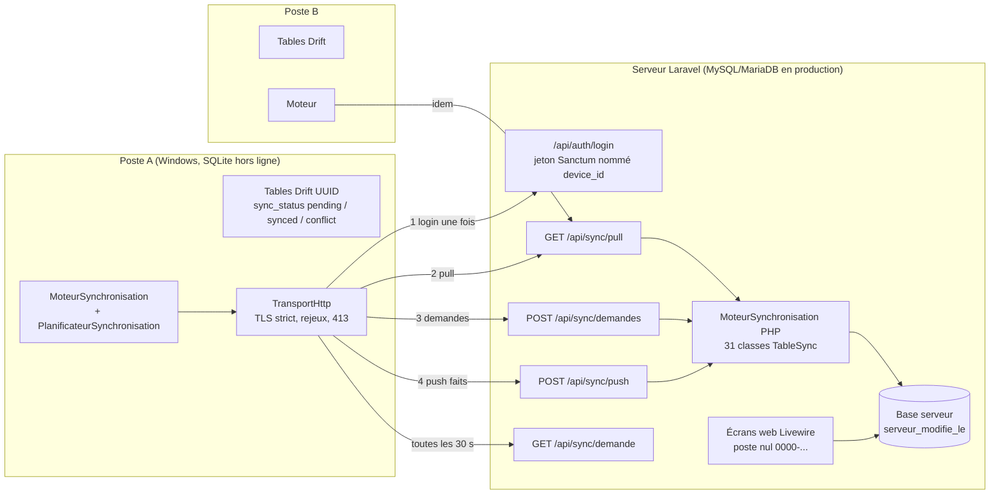

# BLUEPRINT_SYNCHRONISATION_POSTES — Vue d'ensemble de l'architecture poste ↔ web

**Statut : synthèse rédigée le 2026-11-11, vérifiée contre le code** (`logialvia_laravel/app/Sync`, `logialvia_laravel/routes/api.php`, `logialvia_laravel/config/logialvia.php`, `logialvia_app/lib/core/sync`, `logialvia_app/lib/main.dart`). Ce document **synthétise** sans recopier : le détail de chaque règle reste dans les documents cités. En cas d'écart entre un document de conception et le code, le code fait foi (écarts relevés au §12).

Documents de référence :

| Sujet | Document |
|---|---|
| Plan d'exécution (décisions DV-19, DV-20, DV-21 ; paliers P1 à P9, W0 à W4) | `45_PLAN_APPAIRAGE_SYNCHRO_POSTE_WEB.md` |
| Spécification d'origine (appairage, modale, alertes) | `43_APPAIRAGE_SYNCHRO_MODALE_ALERTES.md` |
| Contrat de synchronisation (**brouillon P0 enrichi par ajouts datés**) | `46_CONTRAT_SYNCHRONISATION.md` |
| Règles par famille de tables | `46a_` (fiches, bandes), `46b_` (couveuse), `46c_` (soins), `46d_` (comptabilité), `46e_` (factures e-MECeF), `46f_` (décisions à valider) |
| Droits des postes et horloge | `47g_DROITS_POSTES_ET_HORLOGE.md` |
| Stock ciblé (exception à « le web n'a aucun stock ») | `47s_STOCK_CIBLE.md` |
| Preuve contre le vrai serveur | `47h_PREUVE_VRAI_SERVEUR.md` |
| MySQL/MariaDB et réseau réel | `47r_MYSQL_ET_RESEAU_REEL.md` |

## 1. Principe

- Le **serveur (web Laravel) est la vérité**. Le **poste** (Flutter Windows, base SQLite/Drift locale) travaille **hors ligne** et se synchronise ensuite.
- Un cycle fait toujours : **recevoir** (pull), puis envoyer les **demandes** de référentiel, puis envoyer les **faits** (push). Ordre vérifié dans `MoteurSynchronisation._synchroniser` (`logialvia_app/lib/core/sync/moteur_synchronisation.dart`).
- Le poste n'écrit pas les décisions lourdes : il envoie un **fait** (saisi, rejoué tel quel par le serveur) ou une **demande** (proposition de modification d'un référentiel, que le serveur décide). Le serveur seul calcule les numéros de pièces comptables et génère les écritures de clôture (`46_` §1 ; `47c_`).
- Le poste **conserve ses comptes locaux** (DV-20, `45_` §2) : l'appairage ne sert qu'à synchroniser, la connexion à l'application reste locale. Les tables `utilisateurs`, `roles`, `permissions_role`, `preferences_poste`, `corbeille`, `audit_logs`, `security_logs` ne sont pas synchronisées (`46_` §2.1).
- Le web n'a **aucun stock** : le stock et le PMP restent **propres à chaque poste** ; seul un **journal des mouvements** est partagé (`46_` §14-§15). Exception : le **stock ciblé** (§8).

## 2. Schéma d'ensemble



Schéma ASCII équivalent :

```text
 Poste A (hors ligne)                         Serveur Laravel                          Poste B
 ┌──────────────────┐   login (1 fois)    ┌────────────────────┐                  ┌──────────────┐
 │ tables Drift UUID│ ──────────────────► │ jeton Sanctum      │                  │ tables Drift │
 │ pending/synced/  │   ◄── token, droits │ nom = device_id    │                  └──────┬───────┘
 │ conflict         │                     │ code de poste P<n> │                         │
 │                  │   1. GET pull       │                    │   1. GET pull           │
 │ Moteur + Planif. │ ◄────────────────── │ TableSync x 31     │ ──────────────────────► │
 │                  │   2. POST demandes  │ (référentiels :    │                         │
 │                  │ ──────────────────► │  serveur gagne)    │                         │
 │                  │   3. POST push      │ (faits : dernier   │                         │
 │                  │ ──────────────────► │  écrivain gagne)   │ ◄── push du poste B ─── │
 │                  │   ◄── accepted /    │ base + serveur_    │                         │
 │                  │       rejected      │ modifie_le         │                         │
 └──────────────────┘                     └─────────▲──────────┘                         
                                                    │ écrans web (poste nul)
                                              navigateur (PWA : fichiers statiques seulement)
```

## 3. Appairage : un jeton Sanctum par poste

Sources : `logialvia_laravel/app/Http/Controllers/Api/AuthController.php`, `app/Services/PostesService.php`, `app/Models/Poste.php`, `logialvia_app/lib/core/sync/service_appairage.dart`, `depot_jeton_sync.dart`, `identifiant_poste.dart`.

1. Le poste possède un **identifiant de poste** (UUID v4 généré une fois, `genererUuidV4`, `identifiant_poste.dart`) et une **adresse du serveur** saisie à l'appairage (`adresse_serveur.dart` : `http://` par défaut pour un réseau local, `https://` sinon). Il n'y a pas d'adresse compilée (`47w_`).
2. Le poste appelle `POST /api/auth/login` avec `identifiant`, `password` et `device_name` = son UUID (obligatoire, validé comme UUID). Aucune limite d'essais côté API (commentaire de `routes/api.php`).
3. `PostesService::appairer` : **un seul jeton actif par poste** (le même `device_id` supprime l'ancien jeton, quel que soit le compte) ; le poste reçoit un **code stable** `P<n+1>` (`Poste::prochainCode`) qu'il garde à la réinstallation ; durée du jeton **90 jours** (`jeton_duree_jours`, `config/logialvia.php`) ; réappairer lève une révocation.
4. La réponse porte : `token`, `expires_at`, `user`, `must_change_password`, `poste {id, code}`, `droits` (§9) et `server_now` (§7). Le jeton est conservé hors base (`depot_jeton_sync.dart` ; secrets : `flutter_secure_storage`, `CLAUDE.md`).
5. Le **nom du jeton est l'identité du poste** : `POST /sync/push`, `/sync/demandes` et `/sync/factures/reserver` passent par le middleware `poste.jeton` (`PosteDuJeton`) : un `device_id` différent du nom du jeton donne **403** (`poste_different_du_jeton`) sans rien écrire.
6. Le middleware `contact.poste` note `dernier_contact_le` à chaque appel. Un mot de passe temporaire n'autorise que `me`, `logout` et le changement de mot de passe (`mdp.change` entoure les routes de synchronisation).
7. **Révocation** : écran web **Paramètres > Postes** (`/parametres/postes`, composant `PostesAppairage`) ou `POST /api/parametres/postes/revoquer` (droit `manage-users`) ; supprime tous les jetons du poste. Le poste reçoit **401** et **se suspend** (`PlanificateurSynchronisation`) jusqu'à un nouvel appairage.
8. Un changement de mot de passe (`/auth/mot-de-passe`) supprime les autres jetons de l'utilisateur.

## 4. L'API `/api/sync`

Routes réelles (`logialvia_laravel/routes/api.php`), toutes sous `auth:sanctum`, `compte.actif`, `contact.poste`, `mdp.change` :

| Appel | Rôle | Garde-fous |
|---|---|---|
| `GET /api/sync/pull?since=&until=&page=` | tirage paginé de toutes les tables que le compte peut lire | `until` fige la borne pendant la pagination ; recouvrement de `since` de 2 s (`SYNC_RECOUVREMENT_SECONDES`) ; 200 lignes par table et par page (`SYNC_LIGNES_PAR_PAGE`) ; le curseur du poste n'avance qu'après la **dernière page** |
| `POST /api/sync/push` | envoi des **faits** : `{device_id, reset_mark, tables:{table:[lignes]}}` | `poste.jeton` (403) ; `reset_mark` inconnue : **409** `remise_a_zero_inconnue` ; tout le lot dans une transaction rejouée (`TransactionRejouee`, interblocages MySQL) ; idempotent par UUID ; réponse table par table : `accepted`, `rejected` (avec `motif`, parfois `code`), `ignored` |
| `POST /api/sync/demandes` | propositions de modification d'un **référentiel**, `{device_id, demandes:[{id, type, saisi_le, donnees}]}` | `poste.jeton` ; le serveur rejoue avec les règles du web (`DemandesReferentiel`) |
| `GET /api/sync/demande` | « synchronise maintenant ? » / « renvoyer vers ce poste » | interrogé toutes les 30 s |
| `POST /api/sync/resynchronisation/acquittement` | le poste a refait un tirage complet | — |
| `POST /api/sync/factures/reserver` | un poste réserve la transmission e-MECeF d'une facture émise au web | un seul poste à la fois, 15 minutes (`46e_`, `47a2_`) |
| `POST /api/auth/login`, `GET /api/auth/me`, `POST /api/auth/logout`, `POST /api/auth/mot-de-passe` | appairage et session | voir §3 |
| `POST /api/parametres/postes/{revoquer,synchroniser,renvoyer}`, `POST /api/parametres/remise-a-zero` | administration des postes | `manage-users` ; remise à zéro : `manage-parametres` + trois verrous (§11) |

Une table est une classe `App\Sync\Tables\*` (étend `TableSync`) déclarée dans `config/logialvia.php`, clé `sync.tables`. L'**ordre de cette liste** est l'ordre de traitement, quel que soit l'ordre du lot reçu.

## 5. Tables synchronisées et tables propres au poste

### 5.1 Ce qui est synchronisé : 31 tables

Le serveur déclare **31** classes dans `sync.tables` ; le poste enregistre **31** `Table*Poste` dans `main.dart` (comptage fait sur les deux fichiers le 2026-11-11). Nature déclarée par `TableSync::nature()` :

| Nature | Tables (nom sur le fil) | Règle |
|---|---|---|
| **Référentiels (10)** : le serveur gagne | `modules_actifs`, `parametres_entreprise`, `produits_vendables`, `intrants`, `baremes_ration`, `taux_ration_poids`, `calendrier_prophylaxie`, `groupes_taxe`, `plan_comptable`, `exercice_comptable` | un push direct est **ignoré** et tracé (`ignored`) ; le poste propose par **demande** ; le résultat redescend au tirage |
| **Faits (21)** : saisis au poste, rejoués | `clients`, `fournisseurs`, `ventes` (avec `lignes_vente`), `devis`, `achats` (avec lignes), `factures` (avec lignes), `mouvements_intrant`, `mouvements_produit`, `effets_stock`, `fiche_journee`, `fiche_ventes_jour`, `bandes`, `machines_incubateur`, `cycle_couveuse`, `soins_calendrier`, `infirmerie`, `ecriture_comptable`, `notes_annexes`, `clotures_periodiques`, `clotures_exercice`, `messages_editeur` | par défaut : insertion ou **dernier écrivain gagne** ; certaines tables ont une règle propre (§6) |

Le classement du contrat `46_` §2 (38 tables du schéma v30, 8 + 10 + 13 + 2 + 5) est **daté** : le schéma du poste est maintenant en version **51** (`AppDatabase.versionSchema`), `messages_editeur` est devenu synchronisée, `machines_incubateur` est un **fait** au serveur, `intrants` est un référentiel côté serveur. Se fier à `config/logialvia.php` et aux `nature()` des classes.

Droits de lecture/écriture par table : `droitLecture()` / `droitEcriture()` / `peutEcrire()` de chaque classe (ex. `ventes` : `view-ventes` / `manage-ventes` ; `ecriture_comptable` : lecture `view-comptabilite`).

### 5.2 Ce qui reste propre au poste

- Comptes, rôles, préférences, corbeille locale, journaux d'audit et de sécurité (`46_` §2.1) ; la base du poste, ses sauvegardes et le jeton d'appairage.
- **Stock et PMP** des produits vendables et des intrants : « stock propre à chaque poste + journal partagé » (décision du client, `46_` §14-§15). Un intrant reçu d'un autre poste arrive avec stock 0 et PMP 0 ; un mouvement ou un achat venant d'un autre poste est stocké avec son `origine` et **n'a aucun effet** sur le stock local (`46_` §12-§15).
- La table locale `effets_appliques` trace les effets de stock déjà appliqués (`47s_` §5).
- Ces éléments ne sont pas des tables du web : le web n'a pas de table de stock (`47s_` §1).

## 6. Identités, numéros et résolution de conflits

### 6.1 UUID et numéros officiels

- **Tout le poste est en UUID** (DV-19). Un UUID aléatoire v4 est généré à la création (`nouvelUuid`, `clientDefault` Drift) ; les données **semées** identiquement sur tous les postes reçoivent un **UUID déterministe v5** (`uuidDeterministe(clé)` : SHA-1 de `logialvia:<clé>`, `identifiant_poste.dart` ; côté serveur `App\Support\UuidDeterministe`) pour ne pas exister en double. Exemples : produits semés (`produit:<sku>|<désignation>`), fiches journalières (`fiche_journee:espece|jour`), pièces de clôture.
- **Références officielles à préfixe de poste** (DV-21, option B, `46_` §3) : `V-P2-2026-001` (vente), `ACH-P2-2026-014` (achat), devis `DV-P2-2026-001` ; le **code de poste** `P<n>` est attribué par le serveur à l'appairage, stable, unique ; un poste jamais appairé garde `P0`. Les pièces créées au web portent `WEB` (`V-WEB-AAAA-NNN`, `app/Services/Commerce/VentesWeb.php`). Unicité garantie par `UNIQUE(reference)`. Une pièce déjà remise au client n'est **jamais renumérotée**.
- Les **pièces comptables** sont numérotées par le **serveur** (`46_` §3, hors champ de l'option B) ; la numérotation fiscale e-MECeF (`FV-`/`FA-`) reste celle de la machine e-MECeF.

### 6.2 Horloge et curseurs

- `updated_at` = instant de **saisie**, UTC, microsecondes (`instantSaisie`, texte ISO 8601), **jamais** l'instant d'envoi : un poste resté trois jours hors ligne ne doit pas battre une saisie plus récente faite ailleurs (`46_` §1).
- `serveur_modifie_le` = instant où le **serveur reçoit** (`colonneCurseur()` des faits). Le tirage se base sur lui, pas sur `updated_at`, sinon une saisie ancienne arrivée tard serait invisible des postes déjà à jour (`46_` §6, testé par `DeuxPostesTest`).
- Le poste mémorise son curseur `since` et ne l'avance qu'après la dernière page du tirage ; `complet` (renvoi) l'efface d'abord.

### 6.3 Résolution de conflits

| Cas | Règle | Source |
|---|---|---|
| Fait par défaut | **dernier écrivain gagne** à l'instant de saisie, **strictement** supérieur ; un rejeu identique est accepté sans effet | `TableSync::absorber` |
| Côté poste, absorption d'une ligne tirée | une ligne locale `pending`/`conflict` n'est remplacée que par une version du serveur **strictement plus récente** ; sinon la saisie locale est conservée et part au prochain envoi | `TablePoste.absorber` (`table_poste.dart`), `46_` §8 |
| Référentiel | le serveur gagne ; push ignoré ; adoption initiale du semis datée du `2000-01-01` pour ne pas écraser une décision déjà prise | `47h_` D1 |
| Ventes, achats, devis | **jamais fusionnés** : chaque vente hors ligne est un fait indépendant ; une vente n'est jamais servie ni envoyée sans ses lignes | `46_` §2.3, §12-§13 |
| Effet d'une vente/achat d'un autre poste | **aucun** (stock, comptabilité, compteurs) : connu, pas rejoué | `46_` §12 |
| Fiche journalière saisie par deux postes | la plus récente reste courante, l'autre est conservée comme variante : plus de perte silencieuse | `46f_`, `47e_` |
| Refus du serveur | la ligne devient `conflict` avec son **motif en français**, affiché au poste ; jamais d'échec silencieux | `46_` §4.2 |
| Clôture annuelle | fait lourd : le serveur a le dernier mot ; refusée, l'exercice est rouvert au poste avec le motif | `46d_` §2.7 ; guide `CLOTURE_EXERCICE_SYSCOHADA.md` |

### 6.4 Pierres tombales (suppressions)

Pas de suppression physique propagée. Au serveur, `supprime_le` existe sur `clients`, `fournisseurs`, `devis`, `cycle_couveuse`, `messages_editeur` (grep de `app/Sync/Tables`). Pour les produits et les intrants, la suppression part par **demande** `archive: true` : le serveur pose `archive_le` et la redistribue ; les autres postes l'archivent dans leur corbeille (restaurable) sauf s'ils l'ont déjà vendu (`46_` §15, `47h_` D4). Une saisie plus récente d'un poste hors ligne désarchive. Les soins et l'infirmerie ne sont jamais supprimés (`46f_`, `46c_` D10). La **remise à zéro** est le seul moyen d'effacer des faits (§11).

## 7. Droits des postes et garde d'horloge (`47g_`)

- **Droits** : le serveur annonce à la connexion, à `GET /api/auth/me` et à chaque tirage (page 1) les droits du compte appairé (`DroitsPoste::pour` : `permissions`, `tables_ecrites`, `tables_lues`, `demandes`). Le poste **ne pousse que ce que le compte peut écrire** ; une saisie sans droit reste `pending` (« en attente de droit »), jamais `conflict`. Refus serveur : `rejected[].code = droit_insuffisant`, non mémorisé, rejouable avec un autre compte. Droits inconnus (ancien serveur) : le poste propose tout.
- **Horloge** : `GardeHorloge::TOLERANCE_SECONDES = 300`. Tout instant de saisie (`updated_at`, `horodatage`, `saisi_le`, `supprime_le`, `archive_le`) en avance de plus de 5 minutes sur le serveur est refusé (`horloge_en_avance`). Le poste mesure son décalage à chaque cycle grâce à `server_now` : avance > 2 min = avertissement ; **> 5 min = envoi suspendu** (le tirage a lieu, rien n'est perdu) ; retard = simple avertissement. Après correction, les instants envoyés sont bornés à l'heure du serveur. Les écrans web (poste nul) sont exemptés.

## 8. Stock ciblé (exception documentée)

Une opération web avec effet de stock (réception d'achat, vente, correction) peut **désigner un poste de stock** (`poste_cible`). Seul ce poste applique l'effet à **son** stock, une seule fois (UUID v5 de `effet:<nature>:<fait>`, table locale `effets_appliques`, trace `effets_stock`). Configuration : `STOCK_CIBLE_OBLIGATOIRE` (défaut `false` : le poste est facultatif, sans poste le fait n'est qu'un journal partagé). Détail : `47s_`.

## 9. Parcours d'un cycle de synchronisation

Déclencheurs (`planificateur_synchronisation.dart`) : ouverture ; **toutes les 30 s** `GET /sync/demande` (si le web a demandé « synchroniser maintenant » ou « renvoyer vers ce poste ») ; **geste** (3 s après la dernière saisie locale en attente) ; **routine toutes les 5 min** ; bouton « Synchroniser maintenant » ; **à la fermeture**, bornée à 4 s. Un poste non appairé ne lance aucun minuteur ; un 401 le suspend.

```text
 1. Contrôles        adresse + jeton présents ? sinon « non appairée »
 2. Adoptions        (une fois) le semis local est proposé : catalogue, intrants, paramètres d'élevage, plan comptable
 3. PULL             GET /api/sync/pull?since=<curseur>&until=<fige>&page=n   (pages jusqu'à last_page)
                     - réception de reset_mark (remise à zéro ?), droits, server_now
                     - absorbeur STRICT par table, dans une transaction locale ; curseur avancé à la dernière page
 4. Horloge ?        écart > 5 min en avance : envoi suspendu, fin du cycle (le tirage est fait)
 5. DEMANDES         POST /api/sync/demandes  (référentiels proposés : produit, intrant, barème, taux, échéance, module, paramètres, compte)
 6. PUSH             POST /api/sync/push, lots plafonnés en lignes et en octets, tables dans l'ordre des dépendances
                     - accepted -> marquerSynchronise(id)  (seulement si updated_at inchangé depuis l'envoi)
                     - rejected -> marquerConflit(id, motif)  (sauf droit_insuffisant / horloge_en_avance : reste pending)
 7. Rapport          nombre reçues / envoyées / acceptées / refusées / ignorées / en attente de droit / saisies perdues
```

Les demandes partent **avant** les faits : un produit créé au poste doit être connu du serveur avant les ventes qui le portent (`46_` §12). Une seule synchronisation à la fois (`_enCours`). Les écrans du poste : onglet **Appairage** (état, droits, horloge, bouton « Réessayer ») et icône de synchronisation de la barre du haut qui ouvre une modale d'état (`7b76086`, `47g_` §1.2).

Côté web, un administrateur peut, depuis **Paramètres > Postes**, demander « Synchroniser » (valable 60 minutes, servie une fois par poste) ou « Renvoyer vers ce poste » (tirage complet, acquitté ensuite) (`46_` §7).

## 10. Pannes réseau et hébergement réel (`47r_`)

Couche HTTP unique du poste : `logialvia_app/lib/core/sync/transport_http.dart`.

| Situation | Comportement |
|---|---|
| Pas de réseau, serveur éteint | état **hors ligne**, ce n'est pas une erreur ; tout reste `pending` ; nouvel essai au tick suivant |
| Coupure en plein échange, 502/503/504/429 | rejeu jusqu'à 3 essais (0,5 s puis 2 s), `Retry-After` respecté et plafonné à 15 s ; **sûr car l'envoi est idempotent par UUID** |
| Réponse lente | message distinct de « hors ligne » ; reprise au cycle suivant ; si le serveur avait traité, le rejeu ne crée rien |
| 413 (limite du corps) | lots plafonnés en octets puis **dichotomie** ; plafond appris |
| TLS invalide (auto-signé, expiré, mauvais nom) | **refus net**, jamais de rejeu, jeton conservé ; la vérification n'est jamais désactivée |
| Redirection http → https | suivie (POST compris) pour le **même hôte** uniquement ; l'adresse corrigée est mémorisée |
| Page HTML d'hébergeur | message clair « page web au lieu de données » |
| 401 de l'application (jeton révoqué/expiré) | le poste oublie son jeton et se suspend ; un 401 qui n'est **pas** celui de l'application ne fait **pas** oublier le jeton |
| En-tête `Authorization` retiré (Apache CGI/FastCGI) | le poste envoie aussi `X-Authorization` ; `RestaurerEnTeteAutorisation` le restaure côté serveur |
| Interblocage MySQL, doublon de concurrence | `TransactionRejouee` rejoue la transaction (`47r_` §2.2 n° 6-7) |
| Fermeture de l'application pendant un envoi | `synchroniserALaFermeture` bornée à 4 s ; la saisie reste `pending` et repart (idempotent) |

## 11. Remise à zéro et resynchronisation

`POST /api/parametres/remise-a-zero` (droit `manage-parametres`) : trois verrous — bascule `REMISE_A_ZERO_ACTIVEE` (défaut `false`, `config/logialvia.php`), mot exact `REMETTRE A ZERO`, audit. Elle efface les tables de faits dans l'ordre inverse des dépendances, préserve comptes, rôles, référentiels et audit, pose une nouvelle `reset_mark`. Un poste qui envoie l'ancienne marque reçoit **409** et doit d'abord recevoir les données ; il purge ses tables et compte les saisies non envoyées perdues (`purger()`).

## 12. Preuves et limites connues

Preuves :
- Serveur : `logialvia_laravel/tests/Feature/Sync/` (30 fichiers : `DeuxPostesTest`, `PushTest`, `PullTest`, `DroitsEtHorlogeTest`, `StockCibleTest`, `PlanVersionGardeTest`, `PortabiliteMysqlTest`, …).
- Poste : `logialvia_app/test/core/sync/` (faux serveur `faux_serveur_sync.dart`, `reseau_defaillant_test.dart`, `droits_et_horloge_poste_test.dart`, `stock_cible_deux_postes_test.dart`, …).
- Vrai serveur : `logialvia_app/test/integration/serveur_reel_test.dart` (74 essais d'après `CLAUDE.md`), `reseau_reel_test.dart` ; lancement : `bash logialvia_app/outils/essai_vrai_serveur.sh` (`ESSAI_RESEAU=1` pour le mandataire réseau). Chiffres historiques de `47h_` (55 essais) et `47g_` (68/68) : antérieurs à l'état actuel.

```bash
bash logialvia_app/outils/essai_vrai_serveur.sh
ESSAI_RESEAU=1 bash logialvia_app/outils/essai_vrai_serveur.sh
cd logialvia_laravel && php artisan test --filter=Sync
```

Écarts et limites relevés :
1. `46_` est un **brouillon** daté (38 tables, « à brancher une par une ») : l'implémentation en couvre 31 sur le fil (§5.1). Le critère « chaque table de `AppDatabase` est dans exactement une catégorie » (`46_` §5) n'a pas de test automatique retrouvé dans `logialvia_app/test` ni `logialvia_laravel/tests` (recherche de « exactement une »).
2. Le web n'a **aucun fonctionnement hors ligne des données** : la PWA (`47x_`) ne met en cache que `/build/`, `/fonts/`, `/icons/` ; aucune page HTML n'est stockée. Le doc `40_PWA_HORS_LIGNE.md` (file d'envoi IndexedDB) est une spécification, non réalisée.
3. Hébergeur mutualisé réel : **non prouvé** (`47r_` §1, §6). Environnements du client déclarés : Laragon (test), cPanel (production) (`47r_`, fin de document).
4. Décisions métier P7 à P9 **non validées par le client** : `46f_`.
5. Alias hérité `bovins` → `ovins` accepté à l'entrée du serveur tant que des postes en schéma < 51 existent (`46_` §16, `App\Sync\AliasHerites`).
6. Un poste dont l'horloge est en retard perd ses « dernier écrivain gagne » sans blocage (`47g_` §5, décision 6, à valider).

## 13. Vérifier ce document

```bash
grep -c "Sync\\\\Tables" logialvia_laravel/config/logialvia.php
grep -c "Table[A-Za-z]*Poste(widget.database)" logialvia_app/lib/main.dart
grep -n "versionSchema" logialvia_app/lib/core/database/app_database.dart
```
